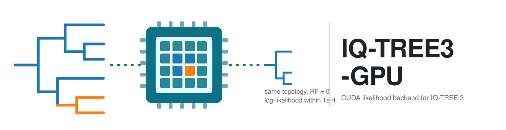

# IQ-TREE3-GPU

<div align="center">
  

  [](LICENSE)
  [](CHANGELOG.md)
  [](https://github.com/kosticlab/iqtree3-gpu/actions/workflows/ci.yml)
  [](https://github.com/iqtree/iqtree3)
  [](docs/DEPENDENCIES.md)
  [](docs/DEPENDENCIES.md)
  [](docs/DEPENDENCIES.md)
  [](benchmark/scripts/harness/README.md)
  [](https://github.com/terry-b-cho/iqtree3-gpu)
</div>

Software accompanying the manuscript **"IQ-TREE3-GPU: GPU-accelerated maximum-likelihood phylogenetic
tree inference for complex amino acid substitution models"** (Cho, Kostic; 2026). IQ-TREE3-GPU moves the
likelihood kernel of [IQ-TREE 3](https://github.com/iqtree/iqtree3) onto an NVIDIA GPU and leaves everything
else about an IQ-TREE run unchanged. One flag, `-gpu`. One promise: **the same tree as CPU IQ-TREE 3,
with identical topology (Robinson-Foulds distance 0) and log-likelihood within 1e-4 relative difference,
checked on every recorded run.** Version 0.1.0 is the version described in the manuscript.

Primary repository: <https://github.com/kosticlab/iqtree3-gpu> (issues and pull requests go there).
Synchronized mirror: <https://github.com/terry-b-cho/iqtree3-gpu>.

## What is in this repository

Two parts, kept apart. **If you want to build trees, you only need the first.**

| Part | Where | What it holds |
|---|---|---|
| **The tool** | repository root | `build_iqtree_gpu.sh`, the patch and CUDA sources (`src/`), a worked example (`examples/`), container recipes (`containers/`), site settings (`config/`), the user guide and dependencies (`docs/`), the verifier and validation harnesses (`scripts/`), and `validation/` for your own harness output |
| **The published benchmark** | [`benchmark/`](benchmark/README.md) | everything behind the manuscript: inputs (`data/`), the measured record (`runs/`), every figure and table (`figures/`, `runs/`), profiling, and the scripts that regenerate them, with [a map of which script makes which figure and table](benchmark/README.md#which-script-makes-what) |

The two share only `config/site.env.example` and `scripts/lib/paths.sh`. Nothing under `benchmark/`
is needed to build, verify or use the tool. The full tree is under [Repository structure](#repository-structure).

## Authors & Contributors

<p align="center">
<a href="https://github.com/terry-b-cho" title="Byeongyeon (Terry) Cho on GitHub"><picture><source media="(prefers-color-scheme: dark) and (max-width: 600px)" srcset="assets/authors/terry-b-cho-phone-dark-top.svg"><source media="(max-width: 600px)" srcset="assets/authors/terry-b-cho-phone-light-top.svg"><source media="(prefers-color-scheme: dark)" srcset="assets/authors/terry-b-cho-desktop-dark-top.svg"></picture></a>&nbsp;<a href="https://github.com/adkostic" title="Aleksandar D. Kostic on GitHub"><picture><source media="(prefers-color-scheme: dark) and (max-width: 600px)" srcset="assets/authors/adkostic-phone-dark-top.svg"><source media="(max-width: 600px)" srcset="assets/authors/adkostic-phone-light-top.svg"><source media="(prefers-color-scheme: dark)" srcset="assets/authors/adkostic-desktop-dark-top.svg"></picture></a><br/>
<a href="https://orcid.org/0000-0003-1370-2629" title="Byeongyeon (Terry) Cho on ORCID"><picture><source media="(prefers-color-scheme: dark) and (max-width: 600px)" srcset="assets/authors/terry-b-cho-phone-dark-bottom.svg"><source media="(max-width: 600px)" srcset="assets/authors/terry-b-cho-phone-light-bottom.svg"><source media="(prefers-color-scheme: dark)" srcset="assets/authors/terry-b-cho-desktop-dark-bottom.svg"></picture></a>&nbsp;<a href="https://orcid.org/0000-0002-0837-4360" title="Aleksandar D. Kostic on ORCID"><picture><source media="(prefers-color-scheme: dark) and (max-width: 600px)" srcset="assets/authors/adkostic-phone-dark-bottom.svg"><source media="(max-width: 600px)" srcset="assets/authors/adkostic-phone-light-bottom.svg"><source media="(prefers-color-scheme: dark)" srcset="assets/authors/adkostic-desktop-dark-bottom.svg"></picture></a>
</p>

## Citation

If you use IQ-TREE3-GPU, please cite **both** of the following
([`assets/CITATION.cff`](assets/CITATION.cff)).

- **This work** (preprint; the DOI will be added here when it is posted): Cho B, Kostic AD. *IQ-TREE3-GPU:
  GPU-accelerated maximum-likelihood phylogenetic tree inference for complex amino acid substitution
  models.* 2026. Version 0.1.0. https://github.com/kosticlab/iqtree3-gpu
- **[IQ-TREE 3](https://github.com/iqtree/iqtree3)** (this tool is a patch against IQ-TREE 3 at commit `6401e06`, reported version 3.1.3):
  Wong TKF, Ly-Trong N, Ren H, Demotte P, Baños H, Roger AJ, Susko E, Bielow C, De Maio N, Goldman N,
  Hahn MW, dos Reis M, Vinh LS, Huttley G, Lanfear R, Minh BQ. *IQ-TREE 3: phylogenomic inference
  software using complex evolutionary models.* Molecular Biology and Evolution. 2026;43(5):msag117.
  https://doi.org/10.1093/molbev/msag117

<details>
<summary>BibTeX for IQ-TREE 3</summary>

```bibtex
@article{10.1093/molbev/msag117,
    author = {Wong, Thomas K F and Ly-Trong, Nhan and Ren, Huaiyan and Demotte, Piyumal and Baños, Hector and Roger, Andrew J and Susko, Edward and Bielow, Chris and De Maio, Nicola and Goldman, Nick and Hahn, Matthew W and dos Reis, Mario and Vinh, Le Sy and Huttley, Gavin and Lanfear, Robert and Minh, Bui Quang},
    title = {IQ-TREE 3: phylogenomic inference software using complex evolutionary models},
    journal = {Molecular Biology and Evolution},
    volume = {43},
    number = {5},
    pages = {msag117},
    year = {2026},
    month = {05},
    issn = {1537-1719},
    doi = {10.1093/molbev/msag117},
    url = {https://doi.org/10.1093/molbev/msag117},
}
```

</details>

When quoting a performance number, also state the exact GPU card used. The benchmark inputs additionally
rely on GTDB, CheckM2 and AliSim; see [`benchmark/data/README.md`](benchmark/data/README.md).

## Quick start

Four commands, on a machine with an NVIDIA GPU, CUDA 12.x, a matching gcc and CMake (details under
[Setup](#setup)). On an Lmod cluster such as HMS O2 the second line loads them; elsewhere skip it.

```bash
GIT_LFS_SKIP_SMUDGE=1 git clone https://github.com/kosticlab/iqtree3-gpu.git && cd iqtree3-gpu   # skips 830 MB of benchmark genomes the tool never reads
module load gcc/14.2.0 cuda/12.8 cmake/3.31.2                      # Lmod clusters only; gcc first
./build_iqtree_gpu.sh                                             # fetches IQ-TREE 3, patches it, builds ./iqtree3_gpu_build/iqtree3 (5-8 min on 8 cores; no GPU needed)
bash scripts/iqtree3-gpu-verify.sh ./iqtree3_gpu_build/iqtree3    # on a GPU node, seconds: kernel engaged, RF = 0, log-likelihood matches
```

Then take your usual IQ-TREE command and add `-gpu`:

```bash
./iqtree3_gpu_build/iqtree3 -gpu -T 20 -s aln.faa -m TESTNEW --ufboot 1000 --alrt 1000 --prefix mytree
```

On a cluster the build can run on a login node; the verifier and your analyses need a GPU allocation
(for example `srun -p gpu --gres=gpu:1 -c 8 --mem 32G --pty bash` on SLURM). This exact sequence was
replayed from a fresh clone on an HMS O2 L40S node: clone 30 s, build 5 min, verifier 1 s, worked example
35 s, and a ModelFinder run on the example alignment 16 s with every likelihood call on the GPU.

## Setup

### Never used IQ-TREE 3?

[IQ-TREE](https://iqtree.github.io/) infers maximum-likelihood phylogenetic trees from a multiple
sequence alignment (FASTA or PHYLIP) and selects the substitution model for you with ModelFinder
(`-m TESTNEW`). IQ-TREE3-GPU is that same program with its likelihood engine on the GPU, so everything
in the [IQ-TREE documentation](https://iqtree.github.io/doc/) applies unchanged. **You do not need
IQ-TREE 3 installed beforehand:** the build script clones the exact upstream commit, applies the patch
and compiles a single binary that runs with or without `-gpu`. If you have no NVIDIA GPU, use the
[upstream IQ-TREE 3 releases](https://github.com/iqtree/iqtree3/releases) instead; the result is the same.

### Requirements

| Need | Version used here | Notes |
|---|---|---|
| NVIDIA GPU with fp64 | compute capability 7.0 to 8.9 tested | V100, RTX 6000/8000, A100, A40, A6000, L40, L40S |
| CUDA toolkit | 12.8 | 12.x expected to work; the runtime needs `libcudart` and `libcublas` on `LD_LIBRARY_PATH` |
| GCC | 14.2.0 | must be a version your CUDA release accepts; on an Lmod cluster **load gcc before cuda** |
| CMake | 3.31.2 | >= 3.18 required |
| Eigen, Boost | 3.4.0, 1.87.0, headers only | used if installed; otherwise the build script downloads them once (~160 MB) into the build tree |
| git, Python 3, curl or wget | any recent | Python only for the verification and analysis scripts |

Exact versions, runtime libraries, compute capabilities and VRAM sizing: [`docs/DEPENDENCIES.md`](docs/DEPENDENCIES.md).

### Build

```bash
module load gcc/14.2.0 cuda/12.8 cmake/3.31.2      # Lmod cluster; gcc first
./build_iqtree_gpu.sh                              # multi-arch build -> ./iqtree3_gpu_build/iqtree3
./build_iqtree_gpu.sh ./iqtree3_gpu_build 89       # optional: pin one arch for a smaller binary (89 L40S, 86 A6000, 80 A100, 70 V100, 75 RTX 6000/8000)
```

The script checks the toolchain first and stops with a one-line hint if anything is missing, clones
IQ-TREE 3 at the pinned commit, applies the patch, and uses the Eigen and Boost headers already on the
machine or downloads them once (checksum-verified) into the build tree. Five to eight minutes on eight
cores; the binary is about 14 MB.

Containers: [`containers/Dockerfile`](containers/Dockerfile) and
[`containers/apptainer.def`](containers/apptainer.def) (Apptainer needs `--nv`).

### Verify on your GPU

Run once per machine and after every rebuild. It checks engagement first (the kernel actually ran), then
equivalence (`rf_dist: 0`, matching log-likelihood).

```bash
bash scripts/iqtree3-gpu-verify.sh ./iqtree3_gpu_build/iqtree3
( cd examples && ./run_example.sh )     # ~2 min worked example: GPU and CPU trees on a small real alignment, RF = 0, tree plot
```

Expected example output is in [`examples/expected_output/`](examples/expected_output/); walkthrough in
[`examples/README.md`](examples/README.md).

## Usage

### Your input

The tool takes what IQ-TREE takes: **a multiple sequence alignment** (amino acid or nucleotide, FASTA or
PHYLIP, one sequence per taxon). It does not take raw genomes. If you start from genome assemblies or
MAGs, build the alignment first with any standard pipeline, for example the concatenated marker-gene
alignment that [GTDB-Tk](https://github.com/Ecogenomics/GTDBTk) `align` produces. The bundled
example alignments were made that way (genes called with Prodigal, markers found with DIAMOND,
aligned with MAFFT, concatenated; see [`examples/data/PROVENANCE.md`](examples/data/PROVENANCE.md)),
and [`examples/run_example.sh`](examples/README.md) shows the whole path from such an alignment to a
tree you can open.

### Run it

Take your normal IQ-TREE command and add `-gpu`. Input, model string, bootstraps, seeds and every output
file behave exactly as in stock IQ-TREE. With no GPU on the node it prints a notice and runs on the CPU.

```bash
module load gcc/14.2.0 cuda/12.8            # runtime libraries
./iqtree3_gpu_build/iqtree3 -gpu -T 20 -s aln.faa -m TESTNEW --ufboot 1000 --alrt 1000 --prefix mytree
```

- **`--gpu-strict`** is computationally identical to `-gpu` but aborts, with the reason and a non-zero
  exit, if any likelihood call fell back to the CPU. Use it for benchmarks and CI.
- **`-T N` is not symmetric.** On the CPU it is N worker threads. On the GPU it drives host-side work only
  and does not change the result. Report comparisons as "CPU, N threads" vs "GPU + N host threads".
- **Proof the GPU ran.** The start-up banner only proves the kernel was installed. The exit line is the
  evidence: `[IQ-TREE3-GPU] GPUSTATS gpu_calls=N cpu_calls=M pct_gpu=...`, with every CPU delegation
  listed by reason.

### What runs on the GPU

| Model / data | Runs on |
|---|---|
| Amino-acid single-matrix reversible models (LG, WAG, JTT, Q.*, ...) with `+F` `+G` `+R` `+I`; ModelFinder (`-m TESTNEW`); `--ufboot`, `--alrt`; `--dating mcmctree` | **GPU** |
| Nucleotide reversible models (JC, HKY, TN, GTR, ...) with `+F` `+G` `+R` `+I` | **GPU** |
| Codon, morphological, binary data; profile mixtures (C10-C60, LG+C20, ...); partitioned analyses; tree mixtures; `+ASC`; rooted, non-reversible, site-specific models | CPU fallback, still exact |
| `-robust-phy`, `-robust-alrt` | refused with a message (per-site order statistics are not a pattern-indexed quantity) |

`-gpu` is always safe: eligibility is decided per call and ineligible work falls back to the CPU.
Full list and untested paths: [`docs/DEPENDENCIES.md`](docs/DEPENDENCIES.md#4-what-the-gpu-path-supports).

### Confirm a real run was equivalent

Run once without `-gpu` and once with it, same `-s`, `-m` and `-seed`, then:

```bash
python3 scripts/rf_logl_check.py mytree_cpu mytree_gpu mycheck
# VERDICT[mycheck]: PASS   rf_dist=0   logl_reldiff=0.0e+00     (PASS = RF 0 and relative difference <= 1e-4)
```

Deeper checks, in increasing scope: `scripts/kernel_unit_test.sh` (kernel vs in-file CPU reference),
`scripts/differential.sh` (per-site, per-rate-category log-likelihoods under a pinned model) and
`scripts/equivalence_matrix.sh` (models x thread counts x support). Details in
[`docs/USER_GUIDE.md`](docs/USER_GUIDE.md).

## Validation

The contract is **algorithmic equivalence to CPU IQ-TREE 3, not bit-identity** (CPU IQ-TREE is not
bit-reproducible against itself across thread counts). Across the 182 paired CPU-vs-GPU runs on the
reported build: topology differed in 0, 100 log-likelihoods were bit-identical and the other 82 differed
by at most 1.9e-6 relative. Every run carries both arms' logs, trees and support files under
[`benchmark/runs/paired/`](benchmark/runs/). Numbers: [`benchmark/runs/KEY_NUMBERS.md`](benchmark/runs/KEY_NUMBERS.md),
a generated file that is authoritative over anything typed here. Your own validation runs
(`scripts/equivalence_matrix.sh`, `scripts/differential.sh`) write to [`validation/`](validation/README.md).

## When it pays off

<div align="center">
  
  <p><em>Figure 2. (a) Speedup vs complexity, 20 threads. (b) Speedup vs complexity, 1 thread. (c) Single- to 20-thread speedup per dataset.</em></p>
</div>

Speedup is CPU wall time / GPU wall time, both arms on the same node, in the same job, from the same
binary. Tree complexity is branches x patterns x rate categories x states^2.

| Workflow | Host threads | n | Median speedup | Range | Break-even complexity |
|---|---|---|---|---|---|
| Amino acid + ModelFinder | 20 | 67 | **3.73x** | 0.49x-7.75x | 1.1e7 |
| Amino acid + ModelFinder | 1 | 17 | **34.2x** | 0.52x-44.6x | |
| Nucleotide, fixed model | 20 | 78 | 0.80x | 0.43x-1.57x | 1.0e9 |
| Nucleotide, fixed model | 1 | 13 | 3.19x | 0.23x-5.28x | |

- **Use it for amino-acid analyses with model selection.** The largest gate-passing analysis went from
  17.6 h to 3.4 h. Model selection is both the dominant phase and the one that accelerates most.
- **Keep fixed-model nucleotide analyses on the host at 20 threads.** The GPU was slower in 63 of 78 runs;
  a 50-taxon, 2,000-pattern, four-category alignment sits two orders of magnitude below break-even.
- **Single-thread or workstation use gains an order of magnitude more.**
- **Request fewer cores with `-gpu` on amino-acid work.** The GPU arm kept a median of 2.0 cores busy
  (90th percentile 8); for the largest analysis the host arm consumed 348 core-hours and the GPU arm 5.8.
  Do not cut cores for nucleotide work, where the GPU arm kept a median 10.3 cores busy.
- **Which card.** Nominal fp64 throughput is a poor guide: an L40S finished within 1.22x of an A100 at one
  seventh its fp64 rate. A 19x spread in specification gave a 3.7x spread in wall time.
- **Device memory.** The arena is `slots x patterns x states x rate-category capacity x 8 B`, with
  capacity 10 under ModelFinder and the model's own count under a fixed model. If that exceeds 70% of card
  memory the engine lowers the capacity, never below the model's own count. On a 48 GB card roughly 0.2 M
  amino-acid patterns at 100 taxa fit under ModelFinder, 0.5 M under a fixed `+G4`; the sizing table is in
  [`docs/USER_GUIDE.md`](docs/USER_GUIDE.md#10a-practical-guidance-when-to-use-it-how-many-cores-to-ask-for-which-card).

## Troubleshooting

| Symptom | Fix |
|---|---|
| `error while loading shared libraries: libcudart.so.12` or `libcublas.so.12` | `module load cuda/12.8` before running; `ldd ./iqtree3_gpu_build/iqtree3 \| grep -E 'cudart\|cublas'` must show no `not found` |
| `GLIBCXX_3.4.31 not found` | `module load gcc/14.2.0` before running |
| `-gpu requested but no CUDA device is visible` | No GPU allocated: request `--gres=gpu:1`, or run without `-gpu` |
| Start-up says a model is on CPU fallback | Expected for mixture, codon, `+ASC`, partitioned models; the result is still equivalent, and `GPUSTATS` names the reason |
| `--gpu-strict FAILED: N of M likelihood calls ran on the CPU` | Not a pure GPU run; drop `--gpu-strict` or choose an eligible model |
| Slower than the CPU | Expected below about 2e7 tree complexity or with few distinct patterns, where launch latency dominates; judge size by `Number of distinct site patterns` in the `.iqtree` report |
| Build stops at `MISSING nvcc` or `MISSING cmake` | The toolchain is not on `PATH`: on an Lmod cluster `module load gcc/14.2.0 cuda/12.8 cmake/3.31.2` (gcc first), elsewhere install the CUDA toolkit and CMake >= 3.18 |
| `Eigen3 library not found` or `Could NOT find Boost` | The build script fetches both when they are absent; if the download is blocked, install them (`apt install libeigen3-dev libboost-dev`, or `conda install -c conda-forge eigen boost-cpp`) or point `EIGEN3_INCLUDE_DIR` / `Boost_INCLUDE_DIR` at the headers |
| Verifier prints FAIL | Do not use the build; recheck the CUDA and gcc modules, rebuild, and report it |

## The published benchmark

Everything behind the manuscript lives in [`benchmark/`](benchmark/README.md), separately from the
tool: the inputs, the measured record, every figure and table, and the scripts that produce them.
Nothing in it is needed to build, verify or use the tool.

| What | Where |
|---|---|
| Which script produces which figure and table | [`benchmark/README.md`](benchmark/README.md) |
| Inputs with provenance: 435 genomes (Git LFS), 35 amino-acid and 26 nucleotide alignments | [`benchmark/data/`](benchmark/data/README.md) |
| Measured record: `RUNS.tsv` (226 rows, 182 on the reported build), per-cell evidence, `KEY_NUMBERS.md` | [`benchmark/runs/`](benchmark/runs/KEY_NUMBERS.md) |
| Figures: panels, lettered composites, previews, Source Data, manifest | [`benchmark/figures/`](benchmark/figures/README.md) |
| Column dictionary for the run table | [`benchmark/BENCHMARK_SCHEMA.md`](benchmark/BENCHMARK_SCHEMA.md) |
| Reproduction, in three tiers | [`benchmark/REPRODUCING.md`](benchmark/REPRODUCING.md) |

```bash
bash benchmark/scripts/refresh_all.sh      # regenerate every figure, table and number from RUNS.tsv (no GPU, ~4 min)
bash scripts/run_tests.sh --quick          # repository invariants, figure contract, map and cross-checks
```

Set `GIT_LFS_SKIP_SMUDGE=1` on clone to skip the 830 MB of genomes. A Zenodo deposit of the complete
record accompanies the manuscript; its DOI will be added to
[`benchmark/REPRODUCING.md`](benchmark/REPRODUCING.md) and [`assets/CITATION.cff`](assets/CITATION.cff) on deposit.

## Repository structure

Two parts, kept apart: the **tool** at the root and the **published benchmark** under `benchmark/`.

```
iqtree3-gpu/
├── README.md · CHANGELOG.md · VERSION · LICENSE    # 0.1.0; GPL-2.0 inherited from IQ-TREE
├── build_iqtree_gpu.sh                # one-command build: clone upstream at the pinned commit, patch, compile
├── src/
│   ├── iqtree3_gpu.patch              # the patch applied to IQ-TREE 3 at commit 6401e06
│   ├── gpu_new_files/                 # gpu_kernels.cu, gpu_kernels.h, phylotreegpu.cpp, gpu_kernels_test.cu
│   └── GPU_KERNEL_DESIGN.md           # kernel design note
├── examples/                          # run_example.sh, three small alignments, expected_output/
├── containers/                        # Dockerfile, apptainer.def
├── config/site.env.example            # site settings: SLURM partition, modules, binaries
├── docs/                              # USER_GUIDE, DEPENDENCIES, CONTRIBUTING, CODE_OF_CONDUCT
├── scripts/
│   ├── iqtree3-gpu-verify.sh          # 30-second gate for your build
│   ├── rf_logl_check.py               # equivalence verdict for any CPU/GPU pair of runs
│   ├── kernel_unit_test.sh · differential.sh · equivalence_matrix.sh   # deeper validation (SLURM)
│   ├── run_tests.sh                   # every repository invariant, for the tool and the benchmark
│   ├── lib/paths.sh                   # the one place the repository root is resolved
│   └── dev/                           # example-dataset builder, author cards (scripts/dev/README.md)
├── validation/                        # where the validation harnesses write YOUR results
├── assets/                            # CITATION.cff, logo, author cards
│
└── benchmark/                         # THE PUBLISHED BENCHMARK (not needed to use the tool)
    ├── README.md                      # the map: every figure and table -> the script that makes it
    ├── REPRODUCING.md · BENCHMARK_SCHEMA.md
    ├── data/                          # genomes/ (LFS), protein/, dna/ (data/README.md)
    ├── runs/                          # RUNS.tsv, KEY_NUMBERS.md, phase and replicate tables, paired/ evidence, Supplementary Data
    ├── figures/                       # panels/, composites/, previews/, source_data/, Source_Data.xlsx, FIGURE_MANIFEST.tsv
    ├── profiling/                     # Nsight and launch-latency records
    └── scripts/
        ├── refresh_all.sh             # regenerate every table, number, figure and workbook, in order
        ├── *.py                       # one generator per figure or table (benchmark/README.md)
        ├── harness/                   # the paired SLURM benchmark (harness/README.md)
        ├── lib/                       # figdata, figstyle, headline: shared analysis and style
        └── dev/                       # dataset builders, Zenodo packaging (dev/README.md)
```

## Contributing

The one rule: any change that can alter a topology or move a log-likelihood by more than 1e-4 relative is
a breaking change, however much faster it is. See [`docs/CONTRIBUTING.md`](docs/CONTRIBUTING.md) and
[`docs/CODE_OF_CONDUCT.md`](docs/CODE_OF_CONDUCT.md).

## License

GPL-2.0, inherited from IQ-TREE 3 — see [`LICENSE`](LICENSE).
