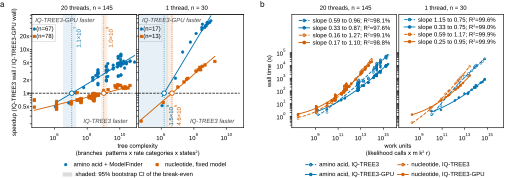

# IQ-TREE3-GPU

<p align="center">
  <strong>GPU-accelerated maximum-likelihood phylogenetic inference</strong><br/>
  The IQ-TREE 3 likelihood kernel on NVIDIA GPUs, with the rest of the inference workflow unchanged.
</p>

<div align="center">
  
  <br/><sub>From alignment to maximum-likelihood tree: the same likelihood calculation on CPU IQ-TREE 3 and on IQ-TREE3-GPU, drawn from the benchmark's own numbers (<a href="assets/animation/README.md">what each stage shows</a>).</sub>

  [](LICENSE)
  [](CHANGELOG.md)
  [](https://github.com/kosticlab/iqtree3-gpu/actions/workflows/ci.yml)
  [](https://doi.org/10.5281/zenodo.22942159)
  [](docs/DEPENDENCIES.md)
  <br/>
  [](https://github.com/iqtree/iqtree3)
  [](docs/DEPENDENCIES.md)
  [](docs/DEPENDENCIES.md)
  [](docs/DEPENDENCIES.md)
  [](docs/DEPENDENCIES.md)
  [](containers/)
  [](benchmark/scripts/harness/README.md)
  [](benchmark/figures_tables/README.md)
</div>

IQ-TREE3-GPU integrates a CUDA likelihood backend directly into [IQ-TREE 3](https://github.com/iqtree/iqtree3),
accelerating computationally intensive phylogenetic inference without replacing its model-selection, tree-search
or branch-support procedures. Enable it with a single flag: `-gpu`. Across 182 paired CPU-GPU benchmark runs the
maximum-likelihood tree topology was identical (Robinson-Foulds distance 0) and every final log-likelihood agreed
within the predefined relative tolerance of 1e-4 (100 of 182 bit-identical). Version 0.1.0 is the version
described in the manuscript *IQ-TREE3-GPU: GPU-accelerated maximum-likelihood phylogenetic tree inference for
complex amino acid substitution models* (Cho, Kostic; 2026).

<h3 align="center">Benchmark performance</h3>

<div align="center">
<table>
  <tr><th><sub>Amino acid + ModelFinder</sub></th><th><sub>Paired runs</sub></th><th><sub>Median speedup</sub></th><th><sub>Range</sub></th></tr>
  <tr><td><sub>20 host threads</sub></td><td align="center"><sub>67</sub></td><td align="center"><sub><b>3.73&times;</b></sub></td><td><sub>0.49&ndash;7.75&times;</sub></td></tr>
  <tr><td><sub>1 host thread</sub></td><td align="center"><sub>17</sub></td><td align="center"><sub><b>34.2&times;</b></sub></td><td><sub>0.52&ndash;44.6&times;</sub></td></tr>
</table>
</div>

<sub>Speedup = IQ-TREE 3 CPU wall time / IQ-TREE3-GPU wall time for the same paired run, same node, same binary. The single-thread runs are small alignments (4&ndash;8 taxa); fixed-model nucleotide analyses gained little at 20 threads (median 0.80&times;). Largest analysis: 65 <i>Colicola</i> genomes, 236,088 sites, L40S, 20 threads: 17.6 h on the CPU, 3.4 h on the GPU (5.12&times;), identical tree.</sub>

<sub>Full results in <a href="#when-it-pays-off">When it pays off</a> and <a href="benchmark/README.md">benchmark/</a>.</sub>

<p align="center">
  <a href="#quick-start"><kbd>&nbsp;Quick start&nbsp;</kbd></a>&ensp;
  <a href="docs/USER_GUIDE.md"><kbd>&nbsp;User guide&nbsp;</kbd></a>&ensp;
  <a href="examples/README.md"><kbd>&nbsp;Worked example&nbsp;</kbd></a>&ensp;
  <a href="benchmark/README.md"><kbd>&nbsp;Benchmark&nbsp;</kbd></a>
</p>

## Authors & Contributors

<p align="center">
<a href="https://github.com/terry-b-cho" title="Byeongyeon (Terry) Cho on GitHub"><picture><source media="(prefers-color-scheme: dark) and (max-width: 600px)" srcset="assets/authors/terry-b-cho-phone-dark-top.svg"><source media="(max-width: 600px)" srcset="assets/authors/terry-b-cho-phone-light-top.svg"><source media="(prefers-color-scheme: dark)" srcset="assets/authors/terry-b-cho-desktop-dark-top.svg"></picture></a>&nbsp;<a href="https://github.com/adkostic" title="Aleksandar D. Kostic on GitHub"><picture><source media="(prefers-color-scheme: dark) and (max-width: 600px)" srcset="assets/authors/adkostic-phone-dark-top.svg"><source media="(max-width: 600px)" srcset="assets/authors/adkostic-phone-light-top.svg"><source media="(prefers-color-scheme: dark)" srcset="assets/authors/adkostic-desktop-dark-top.svg"></picture></a><br/>
<a href="https://orcid.org/0000-0003-1370-2629" title="Byeongyeon (Terry) Cho on ORCID"><picture><source media="(prefers-color-scheme: dark) and (max-width: 600px)" srcset="assets/authors/terry-b-cho-phone-dark-bottom.svg"><source media="(max-width: 600px)" srcset="assets/authors/terry-b-cho-phone-light-bottom.svg"><source media="(prefers-color-scheme: dark)" srcset="assets/authors/terry-b-cho-desktop-dark-bottom.svg"></picture></a>&nbsp;<a href="https://orcid.org/0000-0002-0837-4360" title="Aleksandar D. Kostic on ORCID"><picture><source media="(prefers-color-scheme: dark) and (max-width: 600px)" srcset="assets/authors/adkostic-phone-dark-bottom.svg"><source media="(max-width: 600px)" srcset="assets/authors/adkostic-phone-light-bottom.svg"><source media="(prefers-color-scheme: dark)" srcset="assets/authors/adkostic-desktop-dark-bottom.svg"></picture></a>
</p>

<p align="center">
  <a href="https://github.com/kosticlab/iqtree3-gpu"></a>
  <a href="https://github.com/terry-b-cho/iqtree3-gpu"></a>
</p>

## What is in this repository

Two parts, kept apart. **If you want to build trees, you only need the first.**

<table>
  <tr><th><sub>Part</sub></th><th><sub>Where</sub></th><th><sub>What it holds</sub></th></tr>
  <tr><td><sub><b>The tool</b></sub></td><td><sub>repository root</sub></td><td><sub><code>build_iqtree_gpu.sh</code>, the patch and CUDA sources (<code>src/</code>), a worked example (<code>examples/</code>), container recipes (<code>containers/</code>), site settings (<code>config/</code>), the user guide and dependencies (<code>docs/</code>), the verifier and validation harnesses (<code>scripts/</code>), and <code>validation/</code> for your own harness output</sub></td></tr>
  <tr><td><sub><b>The published benchmark</b></sub></td><td><sub><a href="benchmark/README.md"><code>benchmark/</code></a></sub></td><td><sub>everything behind the manuscript: inputs (<code>data/</code>), the measured record (<code>runs/</code>), every figure and table (<code>figures/</code>, <code>runs/</code>), the harness that produced the record (<code>scripts/</code>) and the code that regenerates every figure and table from it (<code>figures_tables/</code>), with <a href="benchmark/README.md#which-section-makes-what">a map of which section makes which figure and table</a></sub></td></tr>
</table>

The two share only `config/site.env.example` and `scripts/lib/paths.sh`. Nothing under `benchmark/`
is needed to build, verify or use the tool. The full tree is under [Repository structure](#repository-structure).

## Citation

If you use IQ-TREE3-GPU, please cite both IQ-TREE3-GPU and IQ-TREE 3 ([`assets/CITATION.cff`](assets/CITATION.cff)).

**IQ-TREE3-GPU** (preprint; the DOI will be added here when it is posted)

Cho B, Kostic AD. *IQ-TREE3-GPU: GPU-accelerated maximum-likelihood phylogenetic tree inference for complex
amino acid substitution models.* 2026. Version 0.1.0. [Repository](https://github.com/kosticlab/iqtree3-gpu) ·
[Citation metadata](assets/CITATION.cff)

**IQ-TREE 3** (this tool is a patch against IQ-TREE 3 at commit `6401e06`, reported version 3.1.3)

Wong TKF et al. *IQ-TREE 3: phylogenomic inference software using complex evolutionary models.* Molecular
Biology and Evolution. 2026;43(5):msag117. [DOI: 10.1093/molbev/msag117](https://doi.org/10.1093/molbev/msag117)

<details>
<summary><strong>Show BibTeX citation</strong></summary>

<br/>

```bibtex
@article{10.1093/molbev/msag117,
    author = {Wong, Thomas K F and Ly-Trong, Nhan and Ren, Huaiyan and Demotte, Piyumal and Baños, Hector and Roger, Andrew J and Susko, Edward and Bielow, Chris and De Maio, Nicola and Goldman, Nick and Hahn, Matthew W and dos Reis, Mario and Vinh, Le Sy and Huttley, Gavin and Lanfear, Robert and Minh, Bui Quang},
    title = {IQ-TREE 3: phylogenomic inference software using complex evolutionary models},
    journal = {Molecular Biology and Evolution},
    volume = {43},
    number = {5},
    pages = {msag117},
    year = {2026},
    month = {05},
    issn = {1537-1719},
    doi = {10.1093/molbev/msag117},
    url = {https://doi.org/10.1093/molbev/msag117},
}
```

</details>

When quoting a performance number, also state the exact GPU card used. The benchmark inputs additionally
rely on GTDB, CheckM2 and AliSim; see [`benchmark/data/README.md`](benchmark/data/README.md).

## Quick start

Four commands, on a machine with an NVIDIA GPU, CUDA 12.x, a matching gcc and CMake (details under
[Setup](#setup)). On an Lmod cluster such as HMS O2 the second line loads them; elsewhere skip it.

```bash
git clone https://github.com/kosticlab/iqtree3-gpu.git && cd iqtree3-gpu
module load gcc/14.2.0 cuda/12.8 cmake/3.31.2                      # Lmod clusters only; gcc first
./build_iqtree_gpu.sh                                             # fetches IQ-TREE 3, patches it, builds ./iqtree3_gpu_build/iqtree3 (5-8 min on 8 cores; no GPU needed)
bash scripts/iqtree3-gpu-verify.sh ./iqtree3_gpu_build/iqtree3    # on a GPU node, seconds: kernel engaged, RF = 0, log-likelihood matches
```

The last line is a one-time check of the build, not part of an analysis. A `-gpu` run is a single
analysis on the GPU: it never runs the CPU tool and never compares anything.

Then take your usual IQ-TREE command and add `-gpu`:

```bash
./iqtree3_gpu_build/iqtree3 -gpu -T 20 -s aln.faa -m TESTNEW --ufboot 1000 --alrt 1000 --prefix mytree
```

On a cluster the build can run on a login node; the verifier and your analyses need a GPU allocation
(for example `srun -p gpu --gres=gpu:1 -c 8 --mem 32G --pty bash` on SLURM). This exact sequence was
replayed from a fresh clone on an HMS O2 L40S node: clone 30 s, build 5 min, verifier 1 s, worked example
35 s, and a ModelFinder run on the example alignment 16 s with every likelihood call on the GPU.

## Setup

### Never used IQ-TREE 3?

[IQ-TREE](https://iqtree.github.io/) infers maximum-likelihood phylogenetic trees from a multiple
sequence alignment (FASTA or PHYLIP) and selects the substitution model for you with ModelFinder
(`-m TESTNEW`). IQ-TREE3-GPU is that same program with its likelihood engine on the GPU, so everything
in the [IQ-TREE documentation](https://iqtree.github.io/doc/) applies unchanged. **You do not need
IQ-TREE 3 installed beforehand:** the build script clones the exact upstream commit, applies the patch
and compiles a single binary that runs with or without `-gpu`. If you have no NVIDIA GPU, use the
[upstream IQ-TREE 3 releases](https://github.com/iqtree/iqtree3/releases) instead; the result is the same.

### Requirements

<table>
  <tr><th><sub>Need</sub></th><th><sub>Version used here</sub></th><th><sub>Notes</sub></th></tr>
  <tr><td><sub>NVIDIA GPU with fp64</sub></td><td><sub>compute capability 7.0 to 8.9</sub></td><td><sub>tested on V100, V100S, RTX 8000, A100, A40 and L40S</sub></td></tr>
  <tr><td><sub>CUDA toolkit</sub></td><td><sub>12.8</sub></td><td><sub>12.x expected to work; the runtime needs <code>libcudart</code> and <code>libcublas</code> on <code>LD_LIBRARY_PATH</code></sub></td></tr>
  <tr><td><sub>GCC</sub></td><td><sub>14.2.0</sub></td><td><sub>must be a version your CUDA release accepts; on an Lmod cluster <b>load gcc before cuda</b></sub></td></tr>
  <tr><td><sub>CMake</sub></td><td><sub>3.31.2</sub></td><td><sub>&gt;= 3.18 required</sub></td></tr>
  <tr><td><sub>Eigen, Boost</sub></td><td><sub>3.4.0, 1.87.0, headers only</sub></td><td><sub>used if installed; otherwise the build script downloads them once (~160 MB) into the build tree</sub></td></tr>
  <tr><td><sub>git, Python 3, curl or wget</sub></td><td><sub>any recent</sub></td><td><sub>Python only for the verification and analysis scripts</sub></td></tr>
</table>

Exact versions, runtime libraries, compute capabilities and VRAM sizing: [`docs/DEPENDENCIES.md`](docs/DEPENDENCIES.md).

### Build

```bash
module load gcc/14.2.0 cuda/12.8 cmake/3.31.2      # Lmod cluster; gcc first
./build_iqtree_gpu.sh                              # multi-arch build -> ./iqtree3_gpu_build/iqtree3
./build_iqtree_gpu.sh ./iqtree3_gpu_build 89       # optional: pin one arch for a smaller binary (89 L40S, 86 A6000, 80 A100, 70 V100, 75 RTX 6000/8000)
```

The script checks the toolchain first and stops with a one-line hint if anything is missing, clones
IQ-TREE 3 at the pinned commit, applies the patch, and uses the Eigen and Boost headers already on the
machine or downloads them once (checksum-verified) into the build tree. Five to eight minutes on eight
cores; the binary is about 14 MB.

**Containers.** Both recipes build from your checkout, so run them from the repository root; CI builds
both on every push and runs the worked example inside each image.

```bash
docker build -f containers/Dockerfile -t iqtree3-gpu:0.1.0 .                       # Docker (needs the NVIDIA Container Toolkit to run with --gpus all)
docker run --rm --gpus all -v "$PWD":/data iqtree3-gpu:0.1.0 iqtree3 -gpu -s /data/aln.faa -m TESTNEW --prefix /data/mytree
apptainer build --fakeroot iqtree3-gpu.sif containers/apptainer.def                 # Apptainer/Singularity, the HPC form; 10-20 min, ~5.5 GB
apptainer exec --nv iqtree3-gpu.sif iqtree3 -gpu -s aln.faa -m TESTNEW --prefix mytree   # --nv binds the host driver; without it there is no GPU
```

Verify an image the same way as a build: `apptainer exec --nv iqtree3-gpu.sif bash /opt/iqtree3-gpu/scripts/iqtree3-gpu-verify.sh iqtree3`,
or the Docker equivalent with `--gpus all`. Some clusters only run images placed under an approved
path; ask your research-computing team where that is.

### Verify on your GPU

Run once per machine and after every rebuild, on a node with a GPU. The verifier checks engagement
first (the kernel actually ran), then equivalence (`rf_dist: 0`, matching log-likelihood); the worked
example then does the same on a real 8-taxon alignment and leaves the tree in `examples/out/`.

```bash
bash scripts/iqtree3-gpu-verify.sh ./iqtree3_gpu_build/iqtree3
( cd examples && ./run_example.sh )     # ~1 min worked example: GPU and CPU trees on a small real alignment, RF = 0, tree plot
```

Expected example output is in [`examples/expected_output/`](examples/expected_output/); walkthrough in
[`examples/README.md`](examples/README.md).

## Usage

### Your input

The tool takes what IQ-TREE takes: **a multiple sequence alignment** (amino acid or nucleotide, FASTA or
PHYLIP, one sequence per taxon). It does not take raw genomes. Starting from genome assemblies or MAGs,
build the alignment first with any standard pipeline, for example the concatenated marker-gene
alignment from [GTDB-Tk](https://github.com/Ecogenomics/GTDBTk) `align`. The bundled examples were made
that way (Prodigal, DIAMOND, MAFFT, concatenation; see
[`examples/data/PROVENANCE.md`](examples/data/PROVENANCE.md)), and
[`examples/run_example.sh`](examples/README.md) takes such an alignment all the way to a tree.

### Run it

Take your normal IQ-TREE command and add `-gpu`. Input, model string, bootstraps, seeds and every output
file behave exactly as in stock IQ-TREE. With no GPU on the node it prints a notice and runs on the CPU.

```bash
module load gcc/14.2.0 cuda/12.8            # runtime libraries
./iqtree3_gpu_build/iqtree3 -gpu -T 20 -s aln.faa -m TESTNEW --ufboot 1000 --alrt 1000 --prefix mytree
```

- **`--gpu-strict`** is computationally identical to `-gpu` but aborts, with the reason and a non-zero
  exit, if any likelihood call fell back to the CPU. Use it for benchmarks and CI.
- **`--gpu-newton host|device`** chooses where the branch-length Newton loop runs. `host` (the default)
  is IQ-TREE's own loop on the CPU with every derivative evaluated on the GPU; it is the configuration
  of every run in the published benchmark. `device` runs the whole loop on the GPU with one host
  round-trip per branch; same routine, same tolerances, unit-tested against the host loop, but not
  benchmarked, so it is opt-in. The choice is printed in the banner and recorded as `newton_mode=` in
  the exit accounting line.
- **`-T N` must not exceed the cores you were given.** IQ-TREE refuses to start otherwise ("more threads
  than CPU cores available"); on a cluster, match `-T` to your allocation (`-c`), or use `-T AUTO`.
- **`-T N` is not symmetric.** On the CPU it is N worker threads. On the GPU it drives host-side work only
  and does not change the result. Report comparisons as "CPU, N threads" vs "GPU + N host threads".
- **Proof the GPU ran.** The start-up banner only proves the kernel was installed. The exit line is the
  evidence: `[IQ-TREE3-GPU] GPUSTATS gpu_calls=N cpu_calls=M pct_gpu=...`, with every CPU delegation
  listed by reason.

### What runs on the GPU

<table>
  <tr><th><sub>Model / data</sub></th><th><sub>Runs on</sub></th></tr>
  <tr><td><sub>Amino-acid single-matrix reversible models (LG, WAG, JTT, Q.*, ...) with <code>+F</code> <code>+G</code> <code>+R</code> <code>+I</code>; ModelFinder (<code>-m TESTNEW</code>); <code>--ufboot</code>, <code>--alrt</code>; <code>--dating mcmctree</code></sub></td><td><sub><b>GPU</b></sub></td></tr>
  <tr><td><sub>Nucleotide reversible models (JC, HKY, TN, GTR, ...) with <code>+F</code> <code>+G</code> <code>+R</code> <code>+I</code></sub></td><td><sub><b>GPU</b></sub></td></tr>
  <tr><td><sub>Codon, morphological, binary data; profile mixtures (C10-C60, LG+C20, ...); partitioned analyses; tree mixtures; <code>+ASC</code>; rooted, non-reversible, site-specific models</sub></td><td><sub>CPU fallback, still exact</sub></td></tr>
  <tr><td><sub><code>-robust-phy</code>, <code>-robust-alrt</code></sub></td><td><sub>refused with a message (per-site order statistics are not a pattern-indexed quantity)</sub></td></tr>
</table>

`-gpu` is always safe: eligibility is decided per call and ineligible work falls back to the CPU.
Full list and untested paths: [`docs/DEPENDENCIES.md`](docs/DEPENDENCIES.md#4-what-the-gpu-path-supports).

### Confirm a real run was equivalent (optional)

Nothing below happens during a normal `-gpu` run. If you want the CPU-vs-GPU comparison for your own
data (a pipeline sanity check, or a speedup number), the wrapper runs the same command twice and
reports both:

```bash
bash scripts/iqtree3-gpu-benchmark.sh ./iqtree3_gpu_build/iqtree3 mytree -s aln.faa -m LG+F+R4 -T 20
# -> wall time: CPU ... s   GPU ... s   speedup ...x
# -> VERDICT[mytree]: PASS   rf_dist=0   logl_reldiff=...        (PASS = RF 0 and relative difference <= 1e-4)
```

It costs one extra full analysis on the CPU. To compare two runs you already have, use the checker
directly: `python3 scripts/rf_logl_check.py mytree_cpu mytree_gpu mycheck`.

Deeper checks, in increasing scope: `scripts/kernel_unit_test.sh` (kernel vs in-file CPU reference),
`scripts/differential.sh` (per-site, per-rate-category log-likelihoods under a pinned model) and
`scripts/equivalence_matrix.sh` (models x thread counts x support). Details in
[`docs/USER_GUIDE.md`](docs/USER_GUIDE.md).

## Validation

The contract is **algorithmic equivalence to CPU IQ-TREE 3, not bit-identity** (CPU IQ-TREE is not
bit-reproducible against itself across thread counts). Across the 182 paired CPU-vs-GPU runs on the
reported build: topology differed in 0, 100 log-likelihoods were bit-identical and the other 82 differed
by at most 1.9e-6 relative. Every run carries both arms' logs, trees and support files under
[`benchmark/runs/paired/`](benchmark/runs/). Numbers: [`benchmark/runs/KEY_NUMBERS.md`](benchmark/runs/KEY_NUMBERS.md),
a generated file that is authoritative over anything typed here. Your own validation runs
(`scripts/equivalence_matrix.sh`, `scripts/differential.sh`) write to [`validation/`](validation/README.md).

## When it pays off

<div align="center">
  
  <p><em>Figure 2. (A) Speedup against tree complexity at 20 host threads (left) and one (right); the ring on the parity line is each workflow's break-even, the band its 95% bootstrap interval. (B) Wall time of IQ-TREE3 (open, dashed) and IQ-TREE3-GPU (filled, solid) against likelihood workload, same two thread counts; the legend gives each fit's slope at the smallest and the largest workload.</em></p>
</div>

Speedup is CPU wall time / GPU wall time, both arms on the same node, in the same job, from the same
binary. Tree complexity is branches x patterns x rate categories x states^2.

<table>
  <tr><th><sub>Workflow</sub></th><th><sub>Host threads</sub></th><th><sub>n</sub></th><th><sub>Median speedup</sub></th><th><sub>Range</sub></th><th><sub>Break-even complexity</sub></th></tr>
  <tr><td><sub>Amino acid + ModelFinder</sub></td><td align="center"><sub>20</sub></td><td align="center"><sub>67</sub></td><td align="center"><sub><b>3.73&times;</b></sub></td><td><sub>0.49&ndash;7.75&times;</sub></td><td><sub>1.1 &times; 10<sup>7</sup></sub></td></tr>
  <tr><td><sub>Amino acid + ModelFinder</sub></td><td align="center"><sub>1</sub></td><td align="center"><sub>17</sub></td><td align="center"><sub><b>34.2&times;</b></sub></td><td><sub>0.52&ndash;44.6&times;</sub></td><td></td></tr>
  <tr><td><sub>Nucleotide, fixed model</sub></td><td align="center"><sub>20</sub></td><td align="center"><sub>78</sub></td><td align="center"><sub>0.80&times;</sub></td><td><sub>0.43&ndash;1.57&times;</sub></td><td><sub>1.0 &times; 10<sup>9</sup></sub></td></tr>
  <tr><td><sub>Nucleotide, fixed model</sub></td><td align="center"><sub>1</sub></td><td align="center"><sub>13</sub></td><td align="center"><sub>3.19&times;</sub></td><td><sub>0.23&ndash;5.28&times;</sub></td><td></td></tr>
</table>

- **Use it for amino-acid analyses with model selection.** The largest gate-passing analysis went from
  17.6 h to 3.4 h. Model selection is both the dominant phase and the one that accelerates most.
- **Keep fixed-model nucleotide analyses on the host at 20 threads.** The GPU was slower in 63 of 78 runs;
  a 50-taxon, 2,000-pattern, four-category alignment sits two orders of magnitude below break-even.
- **Single-thread or workstation use gains an order of magnitude more.**
- **Request fewer cores with `-gpu` on amino-acid work.** The GPU arm kept a median of 2.0 cores busy
  (90th percentile 8); for the largest analysis the host arm consumed 348 core-hours and the GPU arm 5.8.
  Do not cut cores for nucleotide work, where the GPU arm kept a median 10.3 cores busy.
- **Which card.** Speedup rises with complexity on every one of the six cards tested (A100, V100S,
  V100, L40S, A40, RTX 8000; Supplementary Fig. S1D); the hosts differ, so speedups are compared
  within a card only.
- **Device memory.** The arena is `slots x patterns x states x rate-category capacity x 8 B`, with
  capacity 10 under ModelFinder and the model's own count under a fixed model. If that exceeds 70% of card
  memory the engine lowers the capacity, never below the model's own count. On a 48 GB card roughly 0.2 M
  amino-acid patterns at 100 taxa fit under ModelFinder, 0.5 M under a fixed `+G4`; the sizing table is in
  [`docs/USER_GUIDE.md`](docs/USER_GUIDE.md#10a-practical-guidance-when-to-use-it-how-many-cores-to-ask-for-which-card).

## Troubleshooting

<table>
  <tr><th><sub>Symptom</sub></th><th><sub>Fix</sub></th></tr>
  <tr><td><sub><code>error while loading shared libraries: libcudart.so.12</code> or <code>libcublas.so.12</code></sub></td><td><sub><code>module load cuda/12.8</code> before running; <code>ldd ./iqtree3_gpu_build/iqtree3 | grep -E 'cudart|cublas'</code> must show no <code>not found</code></sub></td></tr>
  <tr><td><sub><code>GLIBCXX_3.4.31 not found</code></sub></td><td><sub><code>module load gcc/14.2.0</code> before running</sub></td></tr>
  <tr><td><sub><code>-gpu requested but no CUDA device is visible</code></sub></td><td><sub>No GPU allocated: request <code>--gres=gpu:1</code>, or run without <code>-gpu</code></sub></td></tr>
  <tr><td><sub><code>ERROR: You have specified more threads than CPU cores available</code></sub></td><td><sub>Stock IQ-TREE behaviour: lower <code>-T</code> to the cores you were allocated, or use <code>-T AUTO</code></sub></td></tr>
  <tr><td><sub>Start-up says a model is on CPU fallback</sub></td><td><sub>Expected for mixture, codon, <code>+ASC</code>, partitioned models; the result is still equivalent, and <code>GPUSTATS</code> names the reason</sub></td></tr>
  <tr><td><sub><code>--gpu-strict FAILED: N of M likelihood calls ran on the CPU</code></sub></td><td><sub>Not a pure GPU run; drop <code>--gpu-strict</code> or choose an eligible model</sub></td></tr>
  <tr><td><sub>Slower than the CPU</sub></td><td><sub>Expected below about 2e7 tree complexity or with few distinct patterns, where launch latency dominates; judge size by <code>Number of distinct site patterns</code> in the <code>.iqtree</code> report</sub></td></tr>
  <tr><td><sub>Build stops at <code>MISSING nvcc</code> or <code>MISSING cmake</code></sub></td><td><sub>The toolchain is not on <code>PATH</code>: on an Lmod cluster <code>module load gcc/14.2.0 cuda/12.8 cmake/3.31.2</code> (gcc first), elsewhere install the CUDA toolkit and CMake &gt;= 3.18</sub></td></tr>
  <tr><td><sub><code>Eigen3 library not found</code> or <code>Could NOT find Boost</code></sub></td><td><sub>The build script fetches both when they are absent; if the download is blocked, install them (<code>apt install libeigen3-dev libboost-dev</code>, or <code>conda install -c conda-forge eigen boost-cpp</code>) or point <code>EIGEN3_INCLUDE_DIR</code> / <code>Boost_INCLUDE_DIR</code> at the headers</sub></td></tr>
  <tr><td><sub>Verifier prints FAIL</sub></td><td><sub>Do not use the build; recheck the CUDA and gcc modules, rebuild, and report it</sub></td></tr>
</table>

## The published benchmark

Everything behind the manuscript lives in [`benchmark/`](benchmark/README.md), separately from the
tool: the inputs, the measured record, every figure and table, and the scripts that produce them.
Nothing in it is needed to build, verify or use the tool.

<table>
  <tr><th><sub>What</sub></th><th><sub>Where</sub></th></tr>
  <tr><td><sub>What was measured, and which section produces which figure and table</sub></td><td><sub><a href="benchmark/README.md"><code>benchmark/README.md</code></a></sub></td></tr>
  <tr><td><sub>The function behind every panel, its rows and inputs; how to change a panel</sub></td><td><sub><a href="benchmark/FIGURE_MAP.md"><code>benchmark/FIGURE_MAP.md</code></a></sub></td></tr>
  <tr><td><sub>Inputs: provenance of the 435 genomes and 61 alignments in git; the files themselves on Zenodo (doi:10.5281/zenodo.22942159)</sub></td><td><sub><a href="benchmark/data/README.md"><code>benchmark/data/</code></a></sub></td></tr>
  <tr><td><sub>Measured record: <code>RUNS.tsv</code> (226 rows, 182 on the reported build), per-cell evidence, <code>KEY_NUMBERS.md</code></sub></td><td><sub><a href="benchmark/runs/KEY_NUMBERS.md"><code>benchmark/runs/</code></a></sub></td></tr>
  <tr><td><sub>Figures: panels, lettered composites, Source Data, manifest</sub></td><td><sub><a href="benchmark/figures/README.md"><code>benchmark/figures/</code></a></sub></td></tr>
  <tr><td><sub>Column dictionary for the run table</sub></td><td><sub><a href="benchmark/BENCHMARK_SCHEMA.md"><code>benchmark/BENCHMARK_SCHEMA.md</code></a></sub></td></tr>
  <tr><td><sub>The harness that produced the record</sub></td><td><sub><a href="benchmark/scripts/README.md"><code>benchmark/scripts/</code></a></sub></td></tr>
  <tr><td><sub>The code that regenerates every figure and table</sub></td><td><sub><a href="benchmark/figures_tables/README.md"><code>benchmark/figures_tables/</code></a></sub></td></tr>
  <tr><td><sub>Reproduction, in three tiers</sub></td><td><sub><a href="benchmark/REPRODUCING.md"><code>benchmark/REPRODUCING.md</code></a></sub></td></tr>
</table>

```bash
bash benchmark/figures_tables/refresh_all.sh   # regenerate every figure, table and number from RUNS.tsv (no GPU, ~4 min)
bash scripts/run_tests.sh --quick          # repository invariants, figure contract, map and cross-checks
```

The benchmark inputs (435 source genomes, 35 amino-acid and 26 nucleotide alignments, about 1.1 GB
compressed) are on Zenodo, doi:10.5281/zenodo.22942159, not in git; `bash benchmark/scripts/fetch_benchmark_data.sh alignments`
downloads what the harness needs. Every figure and table regenerates from `benchmark/runs/` without them.

## Repository structure

Two parts, kept apart: the **tool** at the root and the **published benchmark** under `benchmark/`.

```
iqtree3-gpu/
├── README.md · CHANGELOG.md · VERSION · LICENSE    # 0.1.0; GPL-2.0 inherited from IQ-TREE
├── build_iqtree_gpu.sh                # one-command build: clone upstream at the pinned commit, patch, compile
├── src/
│   ├── iqtree3_gpu.patch              # the patch applied to IQ-TREE 3 at commit 6401e06
│   ├── gpu_new_files/                 # gpu_kernels.cu, gpu_kernels.h, phylotreegpu.cpp, gpu_kernels_test.cu
│   └── GPU_KERNEL_DESIGN.md           # kernel design note
├── examples/                          # run_example.sh, three small alignments, expected_output/
├── containers/                        # Dockerfile, apptainer.def
├── config/site.env.example            # site settings: SLURM partition, modules, binaries
├── docs/                              # USER_GUIDE, DEPENDENCIES, CONTRIBUTING, CODE_OF_CONDUCT
├── scripts/
│   ├── iqtree3-gpu-verify.sh          # 30-second gate for your build (run once after building)
│   ├── iqtree3-gpu-benchmark.sh       # optional: run CPU and GPU arms of one command, report speedup + agreement
│   ├── rf_logl_check.py               # equivalence verdict for any CPU/GPU pair of runs
│   ├── kernel_unit_test.sh · differential.sh · equivalence_matrix.sh   # deeper validation (SLURM)
│   ├── run_tests.sh                   # every repository invariant, for the tool and the benchmark
│   ├── lib/paths.sh                   # the one place the repository root is resolved
│   └── dev/                           # example-dataset builder, author cards (scripts/dev/README.md)
├── validation/                        # where the validation harnesses write YOUR results
├── logs/                              # SLURM logs of the harness and validation jobs land here
├── assets/                            # CITATION.cff, logo, author cards
│
└── benchmark/                         # THE PUBLISHED BENCHMARK (not needed to use the tool)
    ├── README.md                      # the map: every figure and table -> the script that makes it
    ├── REPRODUCING.md · BENCHMARK_SCHEMA.md
    ├── data/                          # provenance of genomes/, protein/, dna/; the files come from Zenodo (data/README.md)
    ├── runs/                          # RUNS.tsv, KEY_NUMBERS.md, phase and replicate tables, paired/ evidence, Supplementary Data
    ├── figures/                       # panels/, composites/, source_data/, Source_Data.xlsx, FIGURE_MANIFEST.tsv
    ├── profiling/                     # Nsight and launch-latency records
    ├── figures_tables/                # figures.py, tables.py, lib/, refresh_all.sh: every figure and table from the record
    └── scripts/                       # the benchmark itself: record builders, the SLURM harness, dataset builders
        ├── aggregate_runs.py · phase_extract.py · verify_data.py · fetch_benchmark_data.sh
        ├── harness/                   # the paired SLURM benchmark (harness/README.md)
        └── dev/                       # dataset builders, the Zenodo deposit script (dev/README.md)
```

## Contributing

The one rule: any change that can alter a topology or move a log-likelihood by more than 1e-4 relative is
a breaking change, however much faster it is. See [`docs/CONTRIBUTING.md`](docs/CONTRIBUTING.md) and
[`docs/CODE_OF_CONDUCT.md`](docs/CODE_OF_CONDUCT.md).

## License

GPL-2.0, inherited from IQ-TREE 3 — see [`LICENSE`](LICENSE).
