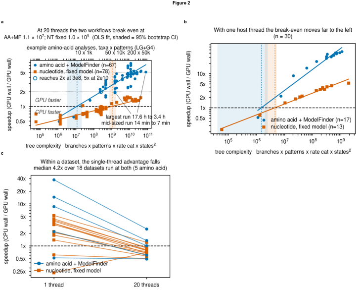

# IQ-TREE3-GPU

<div align="center">
  

  [](LICENSE)
  [](CHANGELOG.md)
  [](https://github.com/kosticlab/iqtree3-gpu/actions/workflows/ci.yml)
  [](https://github.com/iqtree/iqtree3)
  [](DEPENDENCIES.md)
  [](DEPENDENCIES.md)
  [](DEPENDENCIES.md)
  [](scripts/benchmark/README.md)
  [](https://github.com/terry-b-cho/iqtree3-gpu)
</div>

Software accompanying the manuscript **"IQ-TREE3-GPU: GPU-accelerated maximum-likelihood phylogenetic
tree inference for complex amino acid substitution models"** (Cho, Kostic; 2026). IQ-TREE3-GPU offloads
the likelihood kernel of [IQ-TREE 3](https://github.com/iqtree/iqtree3) to an NVIDIA GPU and leaves
everything else about an IQ-TREE run unchanged. One flag, `-gpu`, moves the Felsenstein pruning
computation onto the device; the result is held to the CPU's: **identical topology (Robinson-Foulds
distance 0) and log-likelihood within 1e-4 relative difference, checked on every recorded run.** The
repository ships the backend as a patch against IQ-TREE 3, the one-command build, the paired CPU-vs-GPU
benchmark campaign behind every number in the manuscript, and the scripts that regenerate every table
and figure from the raw run records.

Primary repository: <https://github.com/kosticlab/iqtree3-gpu> (authoritative; issues and pull requests
go there). Synchronized mirror: <https://github.com/terry-b-cho/iqtree3-gpu>.

## Authors & Contributors

<p align="center">
<a href="https://github.com/terry-b-cho" title="Byeongyeon (Terry) Cho on GitHub"><picture><source media="(prefers-color-scheme: dark) and (max-width: 600px)" srcset="assets/authors/terry-b-cho-phone-dark-top.svg"><source media="(max-width: 600px)" srcset="assets/authors/terry-b-cho-phone-light-top.svg"><source media="(prefers-color-scheme: dark)" srcset="assets/authors/terry-b-cho-desktop-dark-top.svg"></picture></a>&nbsp;<a href="https://github.com/adkostic" title="Aleksandar D. Kostic on GitHub"><picture><source media="(prefers-color-scheme: dark) and (max-width: 600px)" srcset="assets/authors/adkostic-phone-dark-top.svg"><source media="(max-width: 600px)" srcset="assets/authors/adkostic-phone-light-top.svg"><source media="(prefers-color-scheme: dark)" srcset="assets/authors/adkostic-desktop-dark-top.svg"></picture></a><br/>
<a href="https://orcid.org/0000-0003-1370-2629" title="Byeongyeon (Terry) Cho on ORCID"><picture><source media="(prefers-color-scheme: dark) and (max-width: 600px)" srcset="assets/authors/terry-b-cho-phone-dark-bottom.svg"><source media="(max-width: 600px)" srcset="assets/authors/terry-b-cho-phone-light-bottom.svg"><source media="(prefers-color-scheme: dark)" srcset="assets/authors/terry-b-cho-desktop-dark-bottom.svg"></picture></a>&nbsp;<a href="https://orcid.org/0000-0002-0837-4360" title="Aleksandar D. Kostic on ORCID"><picture><source media="(prefers-color-scheme: dark) and (max-width: 600px)" srcset="assets/authors/adkostic-phone-dark-bottom.svg"><source media="(max-width: 600px)" srcset="assets/authors/adkostic-phone-light-bottom.svg"><source media="(prefers-color-scheme: dark)" srcset="assets/authors/adkostic-desktop-dark-bottom.svg"></picture></a>
</p>

**Byeongyeon Cho**<sup>1,2,3</sup> and **Aleksandar D. Kostic**<sup>2,3,\*</sup>

<sup>1</sup> Department of Biomedical Informatics, Harvard Medical School, Boston, MA, USA ·
<sup>2</sup> Department of Microbiology and Immunobiology, Harvard Medical School, Boston, MA, USA ·
<sup>3</sup> Section on Pathophysiology and Molecular Pharmacology, Joslin Diabetes Center, Boston, MA, USA ·
<sup>\*</sup> Corresponding author: Aleksandar.Kostic@joslin.harvard.edu

## Citation

If you use IQ-TREE3-GPU, please cite **both** of the following. Machine-readable metadata for this work
are in [`CITATION.cff`](CITATION.cff) (GitHub's "Cite this repository" button).

- **This work** (preprint; the DOI will be added here when it is posted): Cho B, Kostic AD. *IQ-TREE3-GPU:
  GPU-accelerated maximum-likelihood phylogenetic tree inference for complex amino acid substitution
  models.* 2026. Version 0.1.0. https://github.com/kosticlab/iqtree3-gpu
- **[IQ-TREE 3](https://github.com/iqtree/iqtree3)** (this tool is a patch against IQ-TREE 3 at commit `6401e06`, reported version 3.1.3):
  Wong TKF, Ly-Trong N, Ren H, Demotte P, Baños H, Roger AJ, Susko E, Bielow C, De Maio N, Goldman N,
  Hahn MW, dos Reis M, Vinh LS, Huttley G, Lanfear R, Minh BQ. *IQ-TREE 3: phylogenomic inference
  software using complex evolutionary models.* Molecular Biology and Evolution. 2026;43(5):msag117.
  https://doi.org/10.1093/molbev/msag117

<details>
<summary>BibTeX for IQ-TREE 3</summary>

```bibtex
@article{10.1093/molbev/msag117,
    author = {Wong, Thomas K F and Ly-Trong, Nhan and Ren, Huaiyan and Demotte, Piyumal and Baños, Hector and Roger, Andrew J and Susko, Edward and Bielow, Chris and De Maio, Nicola and Goldman, Nick and Hahn, Matthew W and dos Reis, Mario and Vinh, Le Sy and Huttley, Gavin and Lanfear, Robert and Minh, Bui Quang},
    title = {IQ-TREE 3: phylogenomic inference software using complex evolutionary models},
    journal = {Molecular Biology and Evolution},
    volume = {43},
    number = {5},
    pages = {msag117},
    year = {2026},
    month = {05},
    issn = {1537-1719},
    doi = {10.1093/molbev/msag117},
    url = {https://doi.org/10.1093/molbev/msag117},
}
```

</details>

When quoting a performance number, also state the exact GPU card used, as reported in the figures and
tables. The benchmark inputs additionally rely on GTDB, CheckM2 and AliSim; see
[`data/README.md`](data/README.md).

## Setup

**Requirements.** A CUDA GPU with fp64, CUDA 12.8 with a GCC your CUDA release accepts (14.2.0 here),
CMake >= 3.18, Eigen 3.4 and Boost headers. Exact versions, runtime libraries, compute capabilities,
VRAM sizing and the six cards this was validated on are in [`DEPENDENCIES.md`](DEPENDENCIES.md). On an
Lmod cluster, **load gcc before cuda**.

**Build** (one command; clones IQ-TREE 3 at the pinned commit, applies `src/iqtree3_gpu.patch`, builds
`./iqtree3_gpu_build/iqtree3`):

```bash
# on an Lmod cluster, e.g.  module load gcc/14.2.0 cuda/12.8 cmake/3.31.2
./build_iqtree_gpu.sh
```

**Verify on your GPU** (30 seconds: engagement, RF = 0, log-likelihood):

```bash
bash scripts/iqtree3-gpu-verify.sh ./iqtree3_gpu_build/iqtree3
```

**Try the worked example** (about two minutes, three small real alignments; walkthrough in
[`examples/README.md`](examples/README.md)):

```bash
( cd examples && ./run_example.sh )
```

Containers: [`containers/Dockerfile`](containers/Dockerfile) and
[`containers/apptainer.def`](containers/apptainer.def) (run Apptainer with `--nv`).

## Usage

Run IQ-TREE exactly as usual and add `-gpu`. `--gpu-strict` makes the run fail loudly instead of
silently falling back to the CPU, and is recommended whenever you are paying for a GPU:

```bash
./iqtree3_gpu_build/iqtree3 -gpu --gpu-strict -s alignment.faa -m TESTNEW -T 20
```

| Model / data | Runs on |
|---|---|
| Amino-acid single-matrix reversible models (LG, WAG, JTT, Q.*, ...) with `+F` `+G` `+R` `+I`, including ModelFinder (`-m TESTNEW`), `--ufboot`, `--alrt`, `--dating mcmctree` | **GPU** |
| Nucleotide reversible models (JC, HKY, TN, GTR, ...) with `+F` `+G` `+R` `+I` | **GPU** |
| Codon, morphological and binary data; profile mixtures (C10-C60, LG+C20, ...); partitioned analyses; tree mixtures; `+ASC`; rooted, non-reversible and site-specific models | CPU fallback, still exact |

`-gpu` is always safe: eligibility is decided per run and ineligible models fall back to the CPU path.
The full table, the few options that are refused outright, and how to prove the GPU actually ran are in
[`USER_GUIDE.md`](USER_GUIDE.md) (sections 7 and 8). Practical guidance on when the GPU pays off, how
many host threads to request and which card to pick is in USER_GUIDE section 10a.

## Validation

The contract is **algorithmic equivalence to CPU IQ-TREE 3, not bit-identity**: identical topology
(Robinson-Foulds distance 0), log-likelihood within 1e-4 relative difference, and matching SH-aLRT /
UFBoot support. Across the 182 paired CPU-vs-GPU runs on the reported build, topology differed in 0,
100 log-likelihoods were bit-identical and the remaining 82 differed by at most 1.9e-6 relative
([`results/benchmarks/KEY_NUMBERS.md`](results/benchmarks/KEY_NUMBERS.md), a generated file). Every
recorded run carries both arms' logs, trees and support files under `results/benchmarks/paired/`.
`scripts/iqtree3-gpu-verify.sh` applies the same gate to your build, and
`bash scripts/run_tests.sh --gpu` runs it on real alignments.

## Benchmark results

<div align="center">
  
  <p><em>Figure 2. (a) Speedup vs complexity, 20 threads. (b) Speedup vs complexity, 1 thread. (c) Single- to 20-thread speedup per dataset.</em></p>
</div>

Speedup is CPU wall time / GPU wall time, both arms on the same node, in the same job, from the same
binary. Numbers below are copied from the generated
[`results/benchmarks/KEY_NUMBERS.md`](results/benchmarks/KEY_NUMBERS.md); that file, not this table,
is authoritative.

| Workflow | Host threads | n | Median speedup | Range |
|---|---|---|---|---|
| Amino acid + ModelFinder | 20 | 67 | **3.73x** | 0.49x-7.75x |
| Amino acid + ModelFinder | 1 | 17 | **34.2x** | 0.52x-44.6x |
| Nucleotide, fixed model | 20 | 78 | 0.80x | 0.43x-1.57x |
| Nucleotide, fixed model | 1 | 13 | 3.19x | 0.23x-5.28x |

At 20 threads the GPU breaks even at a tree complexity (branches x patterns x rate categories x
states^2) of about 1.1e7 for amino-acid ModelFinder workflows and about 1.0e9 for fixed-model
nucleotide workflows, so the payoff case is protein. Six GPUs spanning roughly a 19x range in fp64
throughput were measured; per-card results are in Figure 5. Column definitions for every results table
are in [`BENCHMARK_SCHEMA.md`](BENCHMARK_SCHEMA.md).

## Data availability

All benchmark inputs are in this repository with full provenance ([`data/README.md`](data/README.md)):

- `data/genomes/`: 435 metagenome-assembled genomes from 8 published studies, one directory per genus,
  with a 42-column metadata table (accessions, host, GTDB-Tk taxonomy, CheckM2 quality). Stored through
  **Git LFS**: a default clone with Git LFS installed fetches them (about 830 MB); set
  `GIT_LFS_SKIP_SMUDGE=1` on clone to skip them and `git lfs pull` later if you need the raw genomes.
- `data/protein/`: the 35 amino-acid alignments built from those genomes.
- `data/dna/`: the 26 simulated nucleotide alignments (12 tracked; 14 exceed GitHub's per-file limit
  and are regenerated locally from their recorded guide tree, model, seed and AliSim log, or installed
  from the Zenodo deposit).
- `results/`: the measured record. `RUNS.tsv` (226 rows; 182 on the reported build), key numbers,
  phase steps, replicate tables, per-cell evidence for both arms, profiling records, and every figure
  with its Source Data.

A Zenodo deposit of the complete record (inputs, results, code) accompanies the manuscript; its DOI will
be written into [`REPRODUCING.md`](REPRODUCING.md) and [`CITATION.cff`](CITATION.cff) on deposit.

## Reproducing

[`REPRODUCING.md`](REPRODUCING.md) describes three tiers:

1. **Verify a build** on your GPU (ships in the repository; minutes).
2. **Regenerate every figure and table** from `results/benchmarks/RUNS.tsv` without a GPU:
   `bash scripts/refresh_all.sh`, then `bash scripts/run_tests.sh --quick` re-checks the figure contract
   and every number quoted in the documentation.
3. **Re-run the benchmark campaign** with the SLURM harness in `scripts/benchmark/` (days; site
   settings in `config/site.env`).

`python3 scripts/verify_data.py` proves `data/` is complete and intact before any of this.

## Modules

| Directory | Purpose | Documentation |
|---|---|---|
| `src/` | The CUDA backend: an approximately 400-line patch to IQ-TREE 3 plus four new CUDA/C++ sources | [GPU_KERNEL_DESIGN.md](src/GPU_KERNEL_DESIGN.md) |
| `build_iqtree_gpu.sh` | One-command build against the pinned upstream commit | [DEPENDENCIES.md](DEPENDENCIES.md) |
| `examples/` | Worked example on small real alignments, with expected output | [examples/README.md](examples/README.md) |
| `scripts/` (top level) | Analysis pipeline: aggregation, key numbers, equivalence checks, figures, Source Data, supplementary tables, the test suite | [REPRODUCING.md](REPRODUCING.md) |
| `scripts/benchmark/` | The paired CPU-vs-GPU benchmark harness, card sweep and profiling (SLURM) | [scripts/benchmark/README.md](scripts/benchmark/README.md) |
| `scripts/dev/` | Dataset builders, Zenodo packaging, author cards, one-off diagnostics; nothing here feeds the published numbers | [scripts/dev/README.md](scripts/dev/README.md) |
| `data/` | Every benchmark input with provenance and metadata | [data/README.md](data/README.md) |
| `results/` | The measured record, profiling and figures | [results/figures/README.md](results/figures/README.md), [BENCHMARK_SCHEMA.md](BENCHMARK_SCHEMA.md) |
| `config/` | Per-site settings (partition, modules, binaries); the tracked example reproduces the measured environment | [config/site.env.example](config/site.env.example) |
| `containers/` | Dockerfile and Apptainer definition | [USER_GUIDE.md](USER_GUIDE.md) |

The tool itself has no dependency on `data/` or `results/`; they are the published evidence behind the
benchmark claims.

## Repository structure

```
iqtree3-gpu/
├── README.md                     # this file
├── USER_GUIDE.md                 # build, flags, verification, performance guidance, troubleshooting
├── DEPENDENCIES.md               # exact versions, runtime libraries, tested GPUs
├── REPRODUCING.md                # the three reproduction tiers
├── BENCHMARK_SCHEMA.md           # column definitions for every results table
├── CHANGELOG.md · VERSION        # 0.1.0
├── CITATION.cff · LICENSE        # citation metadata; GPL-2.0 inherited from IQ-TREE
├── CONTRIBUTING.md · CODE_OF_CONDUCT.md
├── build_iqtree_gpu.sh           # one-command build
├── assets/                       # logo and author cards used by this README
├── config/
│   └── site.env.example          # SLURM partition, modules, binaries
├── containers/
│   ├── Dockerfile
│   └── apptainer.def
├── data/                         # benchmark inputs (data/README.md)
│   ├── genomes/                  # 435 MAGs, Git LFS, genome_metadata.tsv, PROVENANCE.md
│   ├── protein/                  # 35 amino-acid alignments
│   └── dna/                      # 26 nucleotide alignments (12 tracked, 14 regenerable)
├── examples/
│   ├── run_example.sh
│   ├── data/                     # three small real alignments
│   └── expected_output/
├── results/
│   ├── benchmarks/               # RUNS.tsv, KEY_NUMBERS.md, replicate and phase tables, paired/ evidence
│   ├── figures/                  # panels/, previews/, composites/, Source Data, FIGURE_MANIFEST.tsv
│   ├── profiling/                # Nsight and launch-latency records
│   └── validation/
├── scripts/
│   ├── iqtree3-gpu-verify.sh     # 30-second gate for your build
│   ├── run_tests.sh              # --quick (no GPU) / --gpu
│   ├── refresh_all.sh            # regenerate every table, number and figure
│   ├── *.py                      # aggregation, key numbers, equivalence, figures, Source Data
│   ├── benchmark/                # paired_benchmark.sh, submitters, card sweep, profiling
│   ├── dev/                      # dataset builders, Zenodo packaging, author cards
│   └── lib/                      # paths.sh, figure style, shared helpers
└── src/
    ├── iqtree3_gpu.patch         # the patch applied to IQ-TREE 3 at commit 6401e06
    ├── gpu_new_files/            # gpu_kernels.cu, gpu_kernels.h, phylotreegpu.cpp, gpu_kernels_test.cu
    └── GPU_KERNEL_DESIGN.md
```

## Documentation index

| I want to... | Read |
|---|---|
| Build, run, verify and troubleshoot the tool | [`USER_GUIDE.md`](USER_GUIDE.md) |
| Check exact versions and the GPUs it was validated on | [`DEPENDENCIES.md`](DEPENDENCIES.md) |
| Run it end to end in two minutes | [`examples/README.md`](examples/README.md) |
| Read the measured numbers | [`results/benchmarks/KEY_NUMBERS.md`](results/benchmarks/KEY_NUMBERS.md), [`results/figures/README.md`](results/figures/README.md) |
| Understand a results column | [`BENCHMARK_SCHEMA.md`](BENCHMARK_SCHEMA.md) |
| Regenerate figures or re-run the campaign | [`REPRODUCING.md`](REPRODUCING.md), [`scripts/benchmark/README.md`](scripts/benchmark/README.md) |
| Inspect the inputs and their provenance | [`data/README.md`](data/README.md) |
| Understand the kernel | [`src/GPU_KERNEL_DESIGN.md`](src/GPU_KERNEL_DESIGN.md) |
| Contribute | [`CONTRIBUTING.md`](CONTRIBUTING.md), [`CODE_OF_CONDUCT.md`](CODE_OF_CONDUCT.md) |
| See what changed | [`CHANGELOG.md`](CHANGELOG.md) |

## Status

Version 0.1.0 is the version described in the preprint. The engine is feature-complete and validated
across six GPUs; profile-mixture, codon, partitioned and `+ASC` models fall back to the CPU path and
remain exact. `bash scripts/run_tests.sh --quick` checks the repository's invariants without a GPU.

## License

GPL-2.0, inherited from IQ-TREE 3 — see [`LICENSE`](LICENSE).
